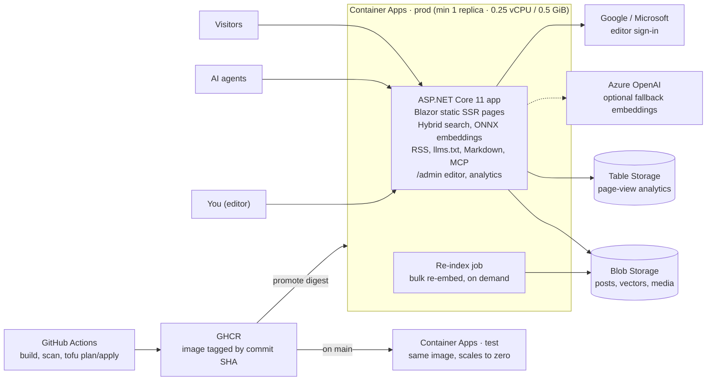

# Weesite — Project Brief (Draft v0.1)

Nov 7, 2026 · @Drazsdik Gergő

## Purpose and scope

Weesite is a small, open-source personal-site engine; gergodrazsdik.com is its first deployment, a custom-built professional website on Azure: contact details and a blog at launch, freelance pages added later. Target running cost is about $5/month with no cold starts on public pages.

**Phase 1 (launch)**

- Home and about page; contact goes through a LinkedIn link (no contact form, no domain email yet)
- Blog with hybrid search, SEO, RSS/Atom and AI-agent support
- Private editor behind Google or Microsoft sign-in
- Analytics
- HTML export of posts, for publishing them elsewhere by hand
- Multi-author support built into the data model from day one, low priority otherwise: an `authors` field on posts, an author page with `Person` JSON-LD per author, and editor users with a role (admin or author)
- Basic CMS: content pages built like posts, included in search, and an editable one-level menu

**Phase 2 (when freelancing starts)**

- Services, availability and contact pages, built as content pages (booking would need more)

**Assumed out of scope (not yet confirmed):** comments, newsletter, a third-party CMS.

## Requirements and constraints

| Area | Requirement |
| --- | --- |
| Platform | Custom ASP.NET Core 11 site; no off-the-shelf CMS with its attack surface |
| Cloud | Azure |
| Frontend | Lightweight and server-rendered, built on modern HTML/CSS/JS platform features with web components in the admin; no framework; light, dark and system modes with a switcher |
| Cost | As low as possible; traffic expected to be minimal |
| Performance | No slow first request (no visible cold start) |
| Blog | Hybrid search, SEO, RSS, AI-agent search support |
| Content | Images plus non-image attachments (PDF etc.) |
| Editor | Basic editing; multiple authors (in the data model, light UI); sign-in with Google or Microsoft Entra ID |
| Analytics | Required; server-side preferred |
| Repo | Public, on a GitHub Free personal account; infrastructure in OpenTofu with its own bootstrap, policy checks and approval-gated deploys |
| Delivery | CI/CD for build, deploy and OpenTofu infrastructure |
| Environments | Separate test and prod |
| Bonus | Export posts as clean HTML for publishing elsewhere by hand (replaces LinkedIn cross-posting) |
| Localization | English content at launch, Hungarian later; the app is localization-ready from day one with English as the only culture |
| Reusability | Generic public codebase: no personal names in code, namespaces, image or resource names; site identity and contact details are configuration, not code |
| CMS | Basic: content pages and a one-level menu, managed in the editor; pages are searchable |
| Design | Simple design built on themeable tokens; colour theme editable in the admin |
| Contact | LinkedIn link from site settings; no contact form; Gmail for now, no email on the domain |

## Hosting decision

**Decided: one ASP.NET Core 11 app on Azure Container Apps (Consumption plan), prod at minimum 1 replica, no Azure CDN.** One deployable, no cold starts on prod, roughly $4–5/month of compute.

- **Replica size:** 0.25 vCPU / 0.5 GiB. A warm replica with no traffic is billed at the idle rate (about $0.000003 per vCPU-second and per GiB-second) after the monthly free allowance of 180,000 vCPU-seconds, 360,000 GiB-seconds and 2 million requests per subscription. ([pricing](https://azure.microsoft.com/pricing/details/container-apps/))
- **Test environment:** scales to zero. A cold start there pulls the image, provisions and starts the app, which takes seconds and is acceptable for test. ([cold start](https://learn.microsoft.com/azure/container-apps/cold-start))
- **Replicas:** cap prod at 1–2 so the in-memory search index (below) doesn't drift between replicas.
- **Edge:** no Azure CDN. Front Door Standard carries a $35/month base fee, and classic Azure CDN can't be created since 1 Oct 2025 and retires 30 Sep 2027. No edge cache or proxy for now (Cloudflare skipped); the app serves static files and media with long cache headers itself. ([CDN vs Front Door pricing](https://learn.microsoft.com/azure/frontdoor/compare-cdn-front-door-price))
- **Region:** one region, Germany West Central (Frankfurt) for everything. Embeddings run inside the app (see Hybrid search), so model availability doesn't constrain the region.
- **Native AOT:** not needed with a warm replica; skipping it keeps Blazor and SQLite simple.

Everything public and private runs in the one prod app; the test app runs the same image and only prod is kept warm.

The architecture (one app, five Azure and external services, test/prod delivery) as a Mermaid diagram, which renders on GitHub:

**Domain and TLS: gergodrazsdik.com**

The domain matches the GitHub username `gergodrazsdik`, so the site and repos share one handle. The domain is deployment configuration; it never appears in the code.

| Hostname | Points to | DNS records | Certificate |
| --- | --- | --- | --- |
| `gergodrazsdik.com` (canonical) | Prod app | `A` to the environment's static IP + `TXT asuid` | Free managed (DigiCert), HTTP validation |
| `www.gergodrazsdik.com` | Prod app, redirects to the bare domain | `CNAME` to the app's generated hostname + `TXT asuid.www` | Free managed |

- Certificates renew automatically as long as the app stays publicly reachable from DigiCert and each CNAME points directly at the app. ([docs](https://learn.microsoft.com/azure/container-apps/custom-domains-managed-certificates))
- If the domain has CAA records, add `0 issue "digicert.com"`.
- Proposed: host the zone in Azure DNS so OpenTofu manages the records; create the managed certificates with `azapi` or an `az containerapp hostname bind` pipeline step, and ignore the binding fields in `lifecycle`.
- No email on the domain for now (Gmail is used). MX, SPF, DKIM and DMARC records can be added to the Azure DNS zone later through OpenTofu.

**Test environment: Azure-generated hostname only**

- Test is served only on its generated `*.azurecontainerapps.io` hostname, with no custom domain. That hostname is covered by Azure's wildcard certificate, so it never shows up in public certificate-transparency logs the way a new custom-domain certificate would.
- It is still reachable by anyone who has the URL, so test also sends `X-Robots-Tag: noindex` on every response and serves a `Disallow: /` robots.txt.
- Optional: restrict test ingress to your own IP addresses, at the cost of smoke tests from GitHub-hosted runners.
- The Google and Microsoft sign-in apps need the test hostname as a redirect URI; it stays stable unless the app or environment is recreated.
- Analytics forwarding is switched off by configuration in test.

## Application stack

**Blazor static server rendering on .NET 11, no interactive render modes.** No SignalR, no WebAssembly; pages are plain server-rendered HTML with hand-written CSS and a small vanilla JS file for the search box.

- **Why Blazor over Razor Pages:** .NET 11's web investment is in richer static SSR and form validation; components can also render to HTML outside a request (keeps a static-export option open) and the editor reuses the same components. Razor Pages would also work. ([.NET Conf 2026](https://devblogs.microsoft.com/dotnet/?p=60656))
- **Runtime:** .NET 11 GA is scheduled for 10 Nov 2026; it is an STS release supported through 9 Nov 2028. ([Visual Studio Magazine](https://visualstudiomagazine.com/articles/2026/07/15/net-11-preview-6-roundup-aspnet-core-maui-c-ef-core-and-sdk-updates.aspx))
- **Markdown:** Markdig, posts stored as Markdown with front matter.

**Localization (English at launch, Hungarian later)**

- UI strings in resource files through `IStringLocalizer` from day one, with `en` as the only culture.
- Posts carry a `lang` field and a translation-group ID, so an English and a Hungarian version can link to each other.
- Proposed URLs: English stays at the root and Hungarian goes under `/hu/` later, so no English URL ever changes.
- When Hungarian lands: `hreflang` alternates, per-language feeds and `llms.txt` sections, and one FTS5 table per language.

**Generic code, configurable identity**

The repo is public, so the code is a generic personal-site engine: nothing in it names you, and everything that identifies the site is configuration.

| Setting | Where it lives | Changed by |
| --- | --- | --- |
| Site name, tagline, author profiles (name, bio, photo, links), contact email, social links | Site settings JSON in Blob | Admin editor |
| Editor users and roles | Site settings in Blob; the first admin's email comes from app configuration | Admin editor |
| Canonical domain and hostnames | OpenTofu variables fed from GitHub environment variables and secrets (`TF_VAR_*`), not committed files | Repo settings |
| Google and Microsoft client IDs and secrets | Container Apps secrets or Key Vault | OpenTofu + manual |
| Feature switches (analytics forwarding) | Container Apps environment variables per environment | OpenTofu |
| Menu (one level: label plus a page or external URL, in order) and home page choice | Site settings JSON in Blob | Admin editor |
| Colour theme (light and dark palettes) | Site settings JSON in Blob, served as /theme.css | Admin theme editor |

- The solution, namespaces, container image and Azure resources use the project name Weesite (`Weesite.*` namespaces, `weesite` image and resource names).
- Local development runs on seed content with a placeholder identity ("Example Author").
- The README explains how to deploy your own instance.

**Content and media storage**

| What | Where | In memory? |
| --- | --- | --- |
| Posts (Markdown + front matter) | Blob Storage, source of truth | Yes: metadata, text, rendered HTML |
| Embeddings per post | Blob Storage (binary file + JSON chunk text) | Yes |
| Images | Private Blob container | No, streamed on request |
| Attachments (PDF, any type) | Private Blob container | No, streamed on request |
| Content pages (Markdown + front matter) | Blob Storage, source of truth | Yes: metadata, text, rendered HTML |

- Media is served through the app at `/media/{hash}-{name}` with long `immutable` cache headers, Content-Type set from the extension and `X-Content-Type-Options: nosniff`.
- Non-image files are served with `Content-Disposition: attachment`.
- Don't run SQLite on an Azure Files share; file locking over the network share is unreliable.

**Content pages and menu (basic CMS)**

- Pages share the posts' Markdown pipeline, storage and editor; a front-matter `kind: page` tells them apart.
- Each page has a slug (`/about`, `/services`), title, language, translation group and a "show in menu" flag.
- Pages have no date and stay out of the feeds, but they are in the sitemap, `llms.txt`, Markdown negotiation, the MCP tools and search, with `WebPage` JSON-LD.
- The home page is configurable: a chosen page, the latest posts, or both.
- The menu is one level: an ordered list of items (label plus a page or an external URL), kept in site settings and reordered in the editor. Labels become per-language once Hungarian arrives.
- Reserved routes (`/blog`, `/admin`, `/media`, `/feed`, `/llms.txt`, `/mcp`) can't be used as page slugs.
- Phase 2's freelance pages are just content pages, with no new code.

Legal pages (a privacy policy now, business details once freelancing starts) will be added later as ordinary content pages.

**Images and attachments**

- Every uploaded image has its EXIF metadata stripped, so camera and GPS location data never leak.
- Resized WebP variants are generated at upload (for example 480, 960 and 1600 px wide) and served with `srcset`, `width` and `height`, so pages don't shift while loading.
- Alt text is required before an image can be inserted into a post or page.
- Library: check licences before choosing. ImageSharp uses the Six Labors Split License rather than Apache-2.0; SkiaSharp (MIT) or NetVips (libvips) are the alternatives.
- SVG uploads are served only as downloads, never inline, because an SVG can carry script.

**Blog features**

- Tags on posts, with tag pages and a feed per tag.
- Related posts under each post, computed from the existing embeddings at no extra cost.
- Reading time, plus published and updated dates.
- Open Graph images: a per-post image from front matter, or an automatically generated card (title and site name) rendered at publish time. Link previews on LinkedIn, Mastodon and chat apps use it.
- Proposed URL scheme: posts at `/blog/{slug}`, pages at `/{slug}`, tags at `/blog/tags/{tag}`, the feed at `/feed.xml`, Hungarian later under `/hu/`. Changing a slug leaves a permanent (301) redirect behind.

## Design and theming

**A simple, content-first design whose look comes entirely from design tokens (CSS custom properties); the colour theme is edited in the admin.**

**Base design (v1)**

- Single-column reading layout (about 70 characters wide); a header with the site name and the one-level menu; a footer with contact and social links from site settings.
- Templates: home, post list, post, content page, search results, 404 and the editor.
- Hand-written CSS of a few KB, no framework, system font stack, responsive from 360 px.
- Light, dark and system modes with a switcher (details below); the default follows `prefers-color-scheme`.
- Code blocks are highlighted on the server, coloured from the same tokens, with no JavaScript.
- Semantic HTML, visible focus states, WCAG AA contrast.

**Light and dark mode**

- A three-way switcher in the header: System (the default), Light and Dark.
- System follows the browser or OS setting through `prefers-color-scheme`, and updates live when the OS switches.
- Colours use CSS `light-dark()` with `color-scheme` on the root, so one set of tokens covers both modes and native controls (scrollbars, form fields) match.
- The choice is kept in a small preference cookie, so the server renders the right mode from the first byte: no flash of the wrong theme and no blocking inline script. It's a functional cookie, which normally needs no consent banner.
- The switch animates with the View Transitions API where the browser supports it.
- The theme editor edits both palettes, and its live preview toggles between them.

**Frontend principles: modern platform features, no frameworks**

- Target browser features that are Baseline "widely available". The public site works fully without JavaScript; scripts only enhance it.
- **CSS:** cascade layers (`@layer` reset, tokens, base, components), native nesting, container queries, `:has()`, `light-dark()`, logical properties.
- **HTML:** `<dialog>`, the Popover API (mobile menu, search panel), `
`, native form validation, and lazy-loaded images with width and height set.
- **JavaScript:** ES modules loaded through an import map, no bundler. If types are wanted, TypeScript output can go into ASP.NET Core's static web assets, which .NET 11 supports.
- **Static assets:** fingerprinted, compressed and served with long cache headers through `MapStaticAssets`.
- **Admin UI from web components** (custom elements, `ws-` prefix for Weesite):

| Component | Purpose |
| --- | --- |
| `<ws-md-editor>` | Markdown editor with toolbar, paste or drop image upload, and server-side preview |
| `<ws-media-picker>` | Browse and upload images and attachments |
| `<ws-menu-editor>` | Reorder menu items by drag and drop or keyboard |
| `<ws-theme-editor>` | Colour pickers, contrast checks, live preview |
| `<ws-theme-switch>` | Public System/Light/Dark switcher; without JavaScript it falls back to a small form post that sets the cookie |

**Design tokens**

| Token group | Examples | Editable in v1 |
| --- | --- | --- |
| Colours | Background, surface, text, muted text, accent, link, border, code background, focus ring | Yes, separately for light and dark |
| Typography | Font stacks, type scale, line height | No: tokens exist with fixed defaults |
| Spacing and shape | Spacing scale, content width, corner radius | No: tokens exist with fixed defaults |

**Theme editor (in site settings)**

- A colour picker per token for light and dark, with a live preview of a sample page beside it.
- A WCAG AA contrast check on every text/background pair; a theme that fails can't be saved.
- A few built-in presets and "reset to default".
- Saved in the site settings JSON in Blob. The app serves it as `/theme.css` (only `:root` variables) at a content-hashed URL with long cache headers, so a change is live on the next page load.
- Only colour values are accepted, never free-form CSS, so the editor can't be used to inject styles or scripts.
- Tests: screenshot snapshots use the default theme; one test switches the theme and checks the variables apply.

## Hybrid search

**Search runs entirely inside the app: SQLite in memory for keyword search, plain arrays for vectors, merged with reciprocal rank fusion (RRF).** No search service, no vector database.

**At publish time**

1. Split the post or page into chunks at its headings.
2. Embed each chunk in-process with the local ONNX model (384 dimensions; see Embedding model below).
3. Write one binary file per post to Blob (model ID, dimensions, vectors) plus a JSON file with the chunk text.
4. Rebuild the in-memory index.

**At query time**

1. Keyword leg: SQLite FTS5 in memory via Microsoft.Data.Sqlite (`Mode=Memory;Cache=Shared`, one connection held open), BM25 ranking, snippets and highlighting.
2. Vector leg: embed the query, brute-force cosine similarity with `TensorPrimitives` over every chunk vector.
3. Merge both rankings with RRF and return the top posts with snippets.

**Sizing:** 1,000 posts × 10 chunks × 384 dimensions × 4 bytes ≈ 15 MB of RAM; a full scan takes around a millisecond.

**Embedding model: local ONNX, inside the app**

- Start with `bge-small-en-v1.5` (English, 384 dimensions), int8-quantized: a few tens of MB, which fits the 0.25 vCPU / 0.5 GiB replica.
- Runs on Microsoft.ML.OnnxRuntime with the BERT tokenizer from Microsoft.ML.Tokenizers, then mean pooling and normalization. The model file is baked into the image.
- Query latency on 0.25 vCPU should be tens of milliseconds (to be measured). Re-embedding a post at publish takes seconds and runs in the background.
- When Hungarian arrives, switch to a multilingual model such as `multilingual-e5-small` and re-embed everything; plan on the 0.5 vCPU / 1 GiB replica then.
- Fallback if ONNX disappoints: `text-embedding-3-small` is available in Germany West Central through EU Data Zone Standard.

**Bulk re-indexing: Container Apps job**

- Bulk work (re-embedding every post after a model change, later PDF text extraction) runs in a Container Apps job, so it never competes with page requests on the 0.25 vCPU web replica.
- Same image as the web app with a different entry point, in the same Container Apps environment, sized at 1–2 vCPU for the length of a run.
- Triggered by a message on an Azure Storage queue, sent by the editor's "re-embed all" action; the job starts when a message arrives.
- Writes the vectors to Blob; the web app then reloads its index (for example by polling a version marker blob).
- Billed only while a run is going: expected to cost cents a month.
- Single posts are still embedded by the web app at publish time. The model also stays in the web app for query embedding, so the job doesn't reduce the web replica's memory.

**Notes**

- FTS5's `porter` stemmer is English-only. For Hungarian posts use `unicode61 remove_diacritics 2` and rely on vectors for meaning.
- Changing the embedding model means re-embedding everything; the editor's "re-embed all" action queues it for the re-index job.
- The index is rebuilt at startup and after each publish; Blob stays the only source of truth.
- Azure AI Search was ruled out: its free tier is a sandbox not meant for production, and paid tiers far exceed the budget.
- Content pages are indexed like posts; results are labelled post or page.

## SEO, feeds and agent support

**Every page is server-rendered HTML with structured data, and every post is also available as clean Markdown for AI agents.**

| Feature | Implementation |
| --- | --- |
| Metadata | Canonical URL, title/description, Open Graph tags |
| Structured data | schema.org JSON-LD: `Person`, `BlogPosting` |
| Crawling | `sitemap.xml`, `robots.txt` |
| Feeds | Atom/RSS feed of posts |
| Agent index | `llms.txt` and `llms-full.txt` |
| Markdown for agents | `Accept: text/markdown` returns Markdown with `Vary: Accept`; `.md` URLs as a fallback |
| Agent tools | MCP endpoint (official MCP C# SDK v2, stateless by default) with tools like `search_content` and `get_content` |

- Claude Code and Cursor already request Markdown through the Accept header; GitHub Copilot and Gemini CLI don't, hence the `.md` URLs too. ([Checkly, Feb 2026](https://www.checklyhq.com/blog/state-of-ai-agent-content-negotation/))
- The `Vary: Accept` header stops caches mixing up the HTML and Markdown versions of a URL.
- Optional later: an NLWeb-style `/ask` endpoint. NLWeb instances expose `/ask` and `/mcp` and answer from the site's schema.org data, so good JSON-LD pays off twice.
- AI crawlers are allowed: `robots.txt` doesn't block GPTBot, ClaudeBot, Google-Extended or similar bots, because the site wants to be read and cited by agents.

## Editor and authentication

**A private `/admin` area inside the same app, signed in with Google or a Microsoft account, open only to allowlisted users, each with a role: admin (everything) or author (own posts only).**

- **Chosen approach:** in-app OpenID Connect handlers (Google + Microsoft) with cookie auth, an email/subject allowlist and a policy on `/admin` only. It works the same locally and in Azure.
- **Alternative:** Container Apps built-in authentication supports Microsoft Entra ID, Google, GitHub and any OpenID Connect provider; run it in "allow unauthenticated" mode and check the injected identity headers on `/admin`. ([docs](https://learn.microsoft.com/azure/container-apps/authentication))
- **Editor features (basic):** posts and pages in a Markdown textarea with server-side preview, front matter fields, image and attachment upload, publish/unpublish, a one-level menu editor, a colour theme editor, re-embed all, HTML export.
- Forms use antiforgery tokens; .NET 11 also adds automatic cross-origin protection for cookie-authenticated endpoints.

**Why in-app sign-in rather than Container Apps' built-in auth**

Decided: sign-in lives in the app (ASP.NET Core's Google and OpenID Connect handlers for Microsoft accounts), not in Container Apps' built-in authentication ("Easy Auth").

|  | In-app sign-in (chosen) | Container Apps built-in auth |
| --- | --- | --- |
| Local development | Real Google and Microsoft sign-in on localhost (localhost redirect URIs registered) | Only works inside Azure; locally it has to be emulated |
| Automated tests | A test auth handler signs in fake users in E2E tests | Tests can only fake the identity headers the platform would inject |
| Portability of the open-source engine | Runs on any host | Ties Weesite to Azure; the identity headers even differ between App Service, Container Apps, Static Web Apps and Functions |
| Code to write | Handler setup, allowlist, roles | Almost none, but .NET doesn't recognise the identity by default and needs a custom auth handler anyway |
| Security patching | Your NuGet updates | Patched by Microsoft |

- Community emulators exist (the EasyAuth Emulator VS Code extension, and EasyAuthDevProxy with an Aspire integration), but they imitate the platform rather than run it, so the real flow would only be tested in Azure. ([EasyAuth Emulator](https://marketplace.visualstudio.com/items?itemName=pnop.easyauth-emulator), [EasyAuthDevProxy](https://github.com/alanta/EasyAuthDevProxy), [.NET and Easy Auth](https://johnnyreilly.com/azure-container-apps-easy-auth-and-dotnet-authentication))
- Microsoft's own answer for App Service is that running Easy Auth locally isn't fully supported. ([Microsoft Q&A](<https://learn.microsoft.com/en-us/answers/questions/1519105/way-to-get-app-service-easyauth-(i-e-authz-authn)>))
- Session hardening: Secure, HttpOnly, SameSite=Lax auth cookie with a sliding expiry; antiforgery on every form; an audit log of admin actions in Table Storage.

**Publishing workflow**

- Draft → preview (an unlisted preview URL only signed-in editors can open) → publish now or at a scheduled time → unpublish.
- Drafts autosave in the editor.
- Revision history comes from Blob versioning; any earlier version can be restored.
- Saves carry the Blob's ETag, so with several authors a stale save is rejected with "changed since you opened it" instead of overwriting someone's work.
- Changing a slug creates the redirect automatically.
- Publishing re-indexes that item, clears its cached pages, and refreshes the sitemap and feeds.

## Analytics

**Server-side page-view logging written by the app itself to Azure Table Storage, shown on an admin page.** Cookieless, so no consent banner, and the only option that also counts AI agents.

- **Recorded per page view:** path, referrer host, a browser / bot / AI-agent label, and a visitor hash with a salt that rotates daily. No IP addresses stored.
- **Cost:** pennies a month.
- **Optional forwarding:** Umami accepts server-side events through its API but needs a valid User-Agent and drops bot traffic; Plausible has a server-side Events API but is paid. ([Umami docs](https://docs.umami.is/docs/guides/send-server-side-events), [Plausible Events API](https://plausible.io/docs/events-api))
- **Full coverage:** with no edge cache in front, every page view reaches the app and gets counted.

## HTML export

**Any post can be exported as clean, portable HTML for publishing elsewhere by hand: LinkedIn articles, newsletters, other blogs. The app never posts anywhere itself.**

- **Output:** semantic HTML limited to widely supported elements: headings (two levels), paragraphs, bold, italic, ordered and unordered lists, blockquotes, inline code and code blocks, horizontal rules, links and images.
- **Two ways out:** copy as rich text to the clipboard (for pasting into a web editor), or download an `.html` file; images are either referenced by absolute URL or bundled in a zip.
- **Title and cover image** are offered separately (the cover is the Open Graph card), because most editors take them in their own fields.
- **Embeds** become plain links by default; a short allowlist of providers can stay as embeds.
- **Unsupported content** (tables, footnotes, custom blocks) is flattened, and the export lists what it changed before you copy it.
- **Optional footer:** "Originally published at" with the canonical link.

## Security hardening

**Headers, input handling and rate limits, sized for a public site on a 0.25 vCPU replica.**

- **Security headers:** HSTS, `X-Content-Type-Options: nosniff`, `Referrer-Policy: strict-origin-when-cross-origin`, a minimal `Permissions-Policy`, and `frame-ancestors 'none'`.
- **Content Security Policy:** strict, with no inline scripts or styles (`default-src 'self'; script-src 'self'; style-src 'self'; img-src 'self' data:; object-src 'none'; base-uri 'self'; form-action 'self'`). The cookie-based theme switch makes this possible.
- **Markdown:** raw HTML in Markdown is disabled or sanitized (for example with HtmlSanitizer), so an author account can't inject script; external links get `rel="noopener"`.
- **Uploads:** an allowlist of file types checked by content, not just extension; a size limit; random stored names; served with `nosniff`, non-images as downloads.
- **Rate limits** (ASP.NET Core's rate limiter): per-IP limits on search, the MCP endpoint and sign-in.
- **Search cost guard:** every query runs the ONNX model, so query length is capped, recent query embeddings are cached, and only a couple of model inferences run at once, keeping pages responsive under a burst of searches.

## Operations

**Backups and export**

- Blob soft delete and versioning (which also gives the editor its revision history), plus container soft delete.
- An "export everything" action in the admin: one zip of Markdown, media and site settings. The same zip imports into another Weesite instance, so content is never locked in.
- OpenTofu state is versioned, soft-deleted and encrypted client-side by the bootstrap's storage account and Key Vault keys.

**Startup, health and deploys**

- The app reports ready only after the search index and the ONNX model have loaded, so Container Apps sends no traffic to a half-started replica, and a new revision takes over only once it's ready.
- Health endpoints are excluded from analytics.

**Monitoring**

- Application Insights through OpenTelemetry, with sampling and a daily data cap so logs stay cheap.
- An availability test on the home page that alerts by email.
- The existing subscription budget alert (see Cost estimate).

**Performance**

- Rendered pages are cached in memory with ASP.NET Core output caching, and cleared for the affected pages on publish.
- Brotli compression for responses; static assets are precompressed by `MapStaticAssets`.
- Proposed targets: under 50 KB of HTML and CSS per page excluding images, Largest Contentful Paint under 1.5 s, almost no layout shift, and a Lighthouse score of 95 or more, checked against the test environment.

## Testing and frontend verification

**All tests use TUnit; browser tests use TUnit.Playwright, and Claude Code checks the UI through Playwright.** TUnit.Playwright provides the same `PageTest`, `ContextTest`, `BrowserTest` and `PlaywrightTest` base classes as Microsoft's NUnit and MSTest packages, creating and disposing the Playwright objects per test. ([TUnit docs](https://tunit.dev/docs/examples/playwright))

| Layer | Tooling | Covers |
| --- | --- | --- |
| Unit | TUnit | Markdown pipeline, search ranking and RRF, slug rules, configuration |
| Integration | TUnit + `WebApplicationFactory` (in memory) + Azurite | Endpoints, feeds, sitemap, `llms.txt`, Markdown negotiation, MCP tools, auth policies |
| End-to-end | TUnit.Playwright + `WebApplicationFactory.UseKestrel()`, Chromium | Pages, menu, search UI, editor flows, localization |
| Accessibility | `Deque.AxeCore.Playwright` | axe checks on every page |
| Visual | Verify (TUnit adapter) with its Playwright extension | Layout regressions at phone and desktop widths, light and dark |

- **E2E host:** the real app on a free Kestrel port (`UseKestrel(0)`), with seed content and a placeholder identity, Azurite for Blob, Table and Queue, and fakes for embeddings (deterministic vectors) and sign-in (a test auth handler). One separate test runs the real ONNX model. ([UseKestrel](https://learn.microsoft.com/dotnet/api/microsoft.aspnetcore.mvc.testing.webapplicationfactory-1.usekestrel))
- **Locators:** by role and label, so tests double as accessibility checks; no sleeps, Playwright's auto-waiting only.
- **CI:** E2E runs on every PR, Chromium only, with browsers cached; traces and screenshots are uploaded as artifacts when a test fails.
- **Fallback:** if TUnit ever gets in the way, Microsoft ships `Microsoft.Playwright.Xunit.v3`, and the new `Microsoft.AspNetCore.Components.Testing` package (Blazor E2E across render modes, built on Playwright, xUnit v3 and YARP) is worth watching.

**Letting Claude Code see the frontend**

- **Playwright MCP** in the repo's Claude Code config: Claude navigates, reads the page's accessibility tree and takes screenshots when the actual look matters.
- **Playwright CLI** for routine checks: it does the same job for about a quarter of the tokens (27K vs 114K per task in one benchmark). ([comparison](https://morphllm.com/playwright-mcp))
- **`just screens`:** starts the app with seed content and writes PNGs of the key pages (home, post, content page, search results, editor) at 390 px and 1280 px, light and dark, into `artifacts/screens/`. Claude Code reads them and compares with the previous set.
- **`CLAUDE.md` rule:** after any UI change, run `just screens` and look at the result before calling the change done.
- **Setup:** `playwright install --with-deps chromium` once. If Claude Code's sandbox blocks the browser from reaching localhost, run the recipe outside the sandbox.

## Local development with Aspire

**One command (`aspire run`) starts the whole site locally with emulated Azure storage, sample content and a telemetry dashboard. Aspire is used only for local development and tests; deployment stays with OpenTofu and GitHub Actions.**

| Project | Role |
| --- | --- |
| `Weesite.AppHost` | Starts Azurite (Blob, Table and Queue emulation), the web app, and the re-index job as an on-demand resource; a seed step loads sample content, site settings and the placeholder identity into Azurite |
| `Weesite.ServiceDefaults` | OpenTelemetry logs, traces and metrics, health checks and HTTP resilience, shared by the app and the job; the same telemetry goes to Application Insights in Azure |

- **Dashboard:** logs, traces and metrics of every local resource in the Aspire dashboard, including the search pipeline's ONNX timings.
- **Claude Code:** `aspire mcp init` configures Claude Code to use the Aspire MCP server, and can also set up the Playwright MCP server and an `AGENTS.md`. Claude can then list resources and their state, read console and structured logs, inspect traces and run resource commands on the running app. ([Aspire 13.1](https://devblogs.microsoft.com/aspire/aspire-13-1-holiday-gift/))
- **Tests:** E2E tests can start the same AppHost through Aspire's testing package (`Aspire.Hosting.Testing`, which works with TUnit), so Playwright runs against exactly what `aspire run` starts, Azurite included. Faster integration tests stay on `WebApplicationFactory`.
- **`just screens`** starts the AppHost, so screenshots always show the seeded sample site.
- **Requirements:** Docker or Podman for the Azurite container. Claude Code's sandbox may not be able to run containers, so Aspire-based runs may need to happen outside it.
- .NET 11 brings smoother Aspire integration, so the AppHost targets the same SDK as the app.

## Repo, CI/CD and environments

**Decided: a public repo on GitHub Free, with its own infrastructure bootstrap.** Public repos get unlimited Actions minutes, environments with required-reviewer approvals, free public images on GHCR and GitHub's security features. Weesite depends on no other project: anyone can fork it and deploy their own site to their own Azure subscription by following `docs/deploy.md`.

**Repo layout:** a fresh repo with `src/` (the app), `tests/`, `infra/bootstrap/` (a one-off OpenTofu root for state, identities and environments), `infra/app/` (the site's resources, one state per environment), `policy/` (the Rego baseline and its tests) and `docs/`. Nothing sensitive or deployment-specific lives in the repo: posts and media are in Blob, secrets in Azure and GitHub, domain names and hostnames in GitHub environment variables.

**Licence: Apache-2.0 with DCO sign-off, set up as in blokky-cli.** `LICENSE` and `NOTICE` files, a CONTRIBUTING section on the Developer Certificate of Origin (no CLA), a CI job on PRs that checks every commit's `Signed-off-by` matches its author, and the same check in the lefthook commit-msg hook. Signed commits are required on `main`.

**Infrastructure bootstrap** (`infra/bootstrap`, run locally once per deployment with `just bootstrap-plan` and `just bootstrap-apply`)

- **State:** resource group `rg-weesite-tfstate` with a storage account (blob versioning, soft delete, Entra ID auth only, shared keys off) and one state container per environment.
- **Encryption:** a Key Vault (RBAC, purge protection) with one key per environment for OpenTofu's client-side state encryption.
- **Environments:** resource groups `rg-weesite-test` and `rg-weesite-prod`.
- **Identities:** a read-only plan identity federated on pull requests and `main`, and one apply identity per environment federated on `environment:test` and `environment:prod`. Each apply identity gets Contributor on its own resource group, plus Role Based Access Control Administrator limited by a condition to the Storage Blob, Table and Queue data roles the site's managed identity needs.
- **GitHub** (through the OpenTofu GitHub provider): environments `test` and `prod`, with `prod` requiring your approval and deploying only from `main` (self-review allowed while you're the only maintainer); Azure IDs as environment secrets; domain and hostnames as environment variables.
- **Budget alert** on both environment resource groups.
- **Inputs** come from a gitignored `bootstrap.auto.tfvars` (a commented `.example` is committed); the GitHub token comes from an environment variable, never a file.
- **State migration:** the first apply runs with local state; `just bootstrap-migrate` then moves bootstrap's own state into the storage account it created, in its own container and encrypted with its own key.

**Pipelines**

| Workflow | Trigger | What it does | Identity |
| --- | --- | --- | --- |
| infra-static | Every PR, forks included | `tofu fmt -check`, `tofu validate`, TFLint, Checkov and conftest on the HCL, `conftest verify` on the policy tests | None |
| infra-plan | Same-repo PRs | `tofu plan` per environment; the plan JSON goes through conftest and Checkov; a change summary goes to the job summary and a PR comment, never the full plan | Plan identity, read-only |
| infra-apply | Merge to `main` | Plans `main`, waits for the environment's approval, applies that saved plan: test first, then prod | Apply identity per environment |
| drift | Weekly | Plans both environments and opens an issue when they drift | Plan identity, read-only |
| app | PR and push to `main` | Build, test, scan; push the image to GHCR tagged with the commit SHA; deploy to test | Test apply identity, `environment:test` |
| promote | Manual | Deploys the same image digest to prod after your approval | Prod apply identity, `environment:prod` |

- OpenTofu owns the Container Apps resources but ignores the image field (`lifecycle`), so app deploys and tofu applies don't undo each other.
- The image is public on GHCR, so Container Apps pulls it without credentials: no PAT to store or rotate.
- Required checks and path filters don't mix (a skipped workflow blocks the merge), so the infra workflows always run and skip their steps when nothing under `infra/` or `policy/` changed.

**Policy baseline:** about ten Rego rules in `policy/`, each covered by `conftest verify` tests: HTTPS only with TLS 1.2 or later, no public blob access, shared keys off, Key Vault purge protection, managed identities instead of stored credentials, required tags and allowed regions. A failing rule fails the check; an exception needs an inline waiver with a reason.

**Standards for agents, not for CI:** `AGENTS.md` points coding agents to the Cloud Adoption Framework's naming, resource abbreviations and tagging guidance, the Microsoft cloud security benchmark and the Container Apps security baseline, the OpenTofu style conventions, and the Azure Verified Modules specifications as guidance. CI enforces only the repo's own baseline. No Infracost: the cost estimate below and the budget alert are enough at this size.

**Public-repo hygiene**

- Azure subscription, tenant and client IDs are environment secrets, so public logs mask them.
- Plans are never posted in full: PR comments carry resource addresses and change counts only.
- The test app's generated hostname can appear in plans and workflow logs; mask it in deploy steps and rely on `noindex` (and the optional IP restriction), not secrecy.
- Workflows from fork PRs get no secrets or OIDC tokens, so they run the static tier only; outside contributors need approval before workflows run.
- The `main` ruleset: PRs only, required checks, signed commits, fast-forward merges (`just merge`).

## Security tooling

**With a public repo, GitHub's security features are free, CodeQL included.**

| Tool | Use |
| --- | --- |
| CodeQL code scanning | C# and GitHub Actions workflows, on PRs and weekly |
| Secret scanning + push protection | On for the repo |
| Dependabot alerts, security and version updates | `nuget`, `docker`, `github-actions`, `terraform` (check it picks up the OpenTofu lock file) |
| Dependency review | Blocks PRs that add vulnerable packages |
| Roslyn analyzers | `AnalysisMode=All`, warnings as errors |
| `dotnet list package --vulnerable --include-transitive` | Fails the build on vulnerable packages |
| grype + syft | Container image scan and SBOM before push (Trivy is out after its March 2026 supply-chain compromise) |
| gitleaks | Secret scan in CI and in the pre-commit hook (lefthook) |
| zizmor | Security analysis of the Actions workflows: injection, over-broad permissions, unpinned actions |
| actionlint, hadolint, shellcheck | Workflow, Dockerfile and shell script linting |
| Checkov + conftest | Misconfigurations and the repo's Rego baseline on every infrastructure PR |

([GitHub Advanced Security](https://docs.github.com/en/get-started/learning-about-github/about-github-advanced-security))

## Cost estimate

**About $5–7/month in total, almost all of it the warm prod replica.** Estimates, not quotes; the gergodrazsdik.com registration is extra.

| Item | $/month |
| --- | --- |
| Container Apps, prod (1 × 0.25 vCPU / 0.5 GiB, mostly idle) | 4–5 |
| Container Apps, test (scales to zero) | \~0 |
| Blob + Table Storage, both environments | < 1 |
| Embeddings (local ONNX, inside the app) | 0 |
| Container Apps job + Storage queue (bulk re-index, on demand) | < 1 |
| Azure DNS zone for gergodrazsdik.com | \~0.5 |
| Logs (keep the volume low or switch log export off) | 0–1 |
| GHCR, GitHub Actions | 0 |

- The Container Apps free allowance is per subscription, so any other hobby workloads in the same subscription share it.
- Egress: the first 100 GB/month to the internet is free, which is far above expected traffic.
- The bootstrap sets a monthly budget alert on the test and prod resource groups (default $30, configurable per deployment).

A multilingual embedding model later likely needs the 0.5 vCPU / 1 GiB replica, which raises prod compute to about $10/month.

## Options considered and rejected

| Option | Why not |
| --- | --- |
| Container Apps scaled to zero for prod | Cold start of several seconds on the first visit; kept for test only |
| Azure Functions (Flex Consumption) | Keeping one instance warm costs \~$21/month (2 GB instance); awkward host for a full Razor/Blazor site |
| Azure Front Door / Azure CDN | $35/month base fee; classic CDN closed to new profiles and retiring Sep 2027 |
| Hugo + Pagefind | Rendering leaves .NET; search, MCP and the editor still need a backend; every edit becomes a Git commit and rebuild; Pagefind is keyword-only |
| Static Web Apps Free | Free plan has only the built-in sign-in providers; Google sign-in and a linked backend need Standard. Remains the basis of a $0 fallback (static export + scale-to-zero API) |
| Azure AI Search | Free tier is a sandbox, paid tiers far over budget |
| Azure Container Registry | \~$5/month; GHCR is free |
| Private repo | Environments with required reviewers need a public repo on Free (or Pro for a private one); CodeQL and secret scanning would be paid too, and a public repo lets others deploy their own Weesite |
| Client-side analytics (cookie-based) | Needs a GDPR consent banner and misses AI agents |
| Azure Functions for indexing | Saves no memory, since queries need the same model in the web app; a Container Apps job reuses the image and environment instead |

## Open questions and next steps

**Open questions**

None right now: every earlier question is settled in the sections above.

**Next steps**

- [ ] Create the public repo and add the solution skeleton (Blazor static SSR app, tests, infra and policy folders)
- [ ] Write `infra/bootstrap` and the Rego baseline with tests; run the first apply, migrate its state into the storage account, and write `docs/deploy.md`
- [ ] Register gergodrazsdik.com and delegate it to Azure DNS. OpenTofu modules: storage, DNS zone, custom domains and certificates, Container Apps environment, app and job
- [ ] Workflows: build/test/scan, image to GHCR, deploy to test, promote to prod, tofu plan/apply
- [ ] Test projects: TUnit unit and integration tests, TUnit.Playwright E2E with axe and screenshot snapshots
- [ ] `just screens` recipe, Playwright MCP config and the `CLAUDE.md` UI rule
- [ ] Content model (with language field), localization plumbing, Markdown pipeline and media endpoint
- [ ] Content pages, menu editor and configurable home page
- [ ] Base design on design tokens, and the colour theme editor with contrast checks
- [ ] Aspire AppHost and ServiceDefaults with Azurite, seed content and `aspire mcp init` for Claude Code
- [ ] Security headers, strict CSP, Markdown sanitization, upload checks and rate limits
- [ ] Image pipeline (EXIF stripping, WebP variants, required alt text) and Open Graph cards
- [ ] Publishing workflow: drafts, preview, scheduling, revisions, ETag conflict checks, redirects
- [ ] Tags, related posts and reading time
- [ ] Backups (soft delete, versioning), export/import zip, readiness probe, monitoring and availability alert
- [ ] Output caching, compression and the performance targets
- [ ] Search index (FTS5 + vectors + RRF) and the ONNX embedding pipeline
- [ ] Re-index job: Container Apps job with a Storage queue trigger
- [ ] SEO, feeds, `llms.txt`, Markdown negotiation, MCP endpoint
- [ ] Editor with sign-in, allowlist and site settings (identity, contact details)
- [ ] Analytics middleware and admin dashboard
- [ ] HTML export (clipboard and file, with change report)

## Sources

- [Azure Container Apps pricing](https://azure.microsoft.com/pricing/details/container-apps/)
- [Azure Container Apps cold start](https://learn.microsoft.com/azure/container-apps/cold-start)
- [Azure Container Apps authentication](https://learn.microsoft.com/azure/container-apps/authentication)
- [Azure CDN vs Front Door pricing](https://learn.microsoft.com/azure/frontdoor/compare-cdn-front-door-price)
- [Azure Static Web Apps plans](https://learn.microsoft.com/azure/static-web-apps/plans)
- [Flex Consumption cost estimate (dev.to)](https://dev.to/martin_oehlert/production-realities-when-azure-functions-stops-being-serverless-p2g)
- [.NET 11 Preview 6 roundup](https://visualstudiomagazine.com/articles/2026/07/15/net-11-preview-6-roundup-aspnet-core-maui-c-ef-core-and-sdk-updates.aspx)
- [.NET Conf 2026 announcement](https://devblogs.microsoft.com/dotnet/?p=60656)
- [Content negotiation for AI agents (Checkly)](https://www.checklyhq.com/blog/state-of-ai-agent-content-negotation/)
- [Umami server-side events](https://docs.umami.is/docs/guides/send-server-side-events)
- [GitHub plans](https://docs.github.com/en/get-started/learning-about-github/githubs-plans)
- [GitHub environments](https://docs.github.com/actions/managing-workflow-runs-and-deployments/managing-deployments/managing-environments-for-deployment)
- [GitHub Advanced Security](https://docs.github.com/en/get-started/learning-about-github/about-github-advanced-security)
- [OpenTofu state encryption](https://opentofu.org/docs/language/state/encryption/), [Conftest](https://www.conftest.dev/), [Checkov](https://www.checkov.io/) and [zizmor](https://docs.zizmor.sh/)
- [TUnit.Playwright](https://tunit.dev/docs/examples/playwright)
- [Playwright for .NET test runners](https://playwright.dev/dotnet/docs/test-runners)
- [WebApplicationFactory.UseKestrel](https://learn.microsoft.com/dotnet/api/microsoft.aspnetcore.mvc.testing.webapplicationfactory-1.usekestrel)
- [Playwright MCP vs CLI token cost](https://morphllm.com/playwright-mcp)
- [Aspire 13.1: AI agents and the Aspire MCP](https://devblogs.microsoft.com/aspire/aspire-13-1-holiday-gift/)
- [EasyAuth Emulator](https://marketplace.visualstudio.com/items?itemName=pnop.easyauth-emulator)
- [EasyAuthDevProxy](https://github.com/alanta/EasyAuthDevProxy)
- [Azure Container Apps, Easy Auth and .NET authentication](https://johnnyreilly.com/azure-container-apps-easy-auth-and-dotnet-authentication)
